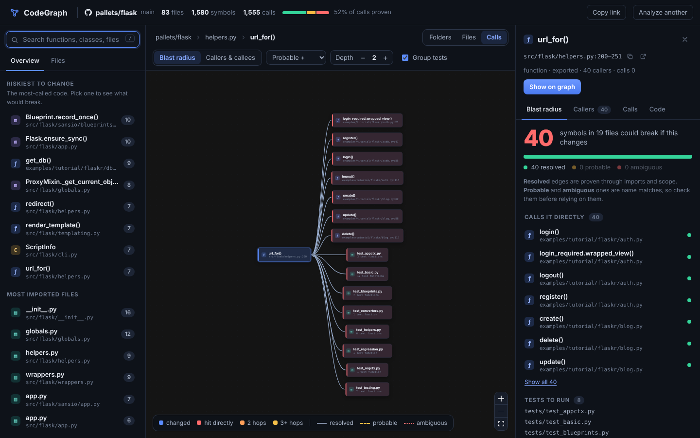

# CodeGraph

[](https://www.npmjs.com/package/codegraph-engine)
[](https://www.npmjs.com/package/codegraph-engine)
[](LICENSE)

**See what breaks before you change it.** An AST dependency, call-graph and blast-radius engine for TypeScript, JavaScript, Python and Go repositories, with a web app that runs entirely in your browser.



Paste a GitHub repository into the web app, or drop a folder, some files or a `.zip` from your computer, and it builds a multi-granular graph (folders → file imports → function calls → local variable dataflow). Nothing is uploaded: the parser is WebAssembly running in a Web Worker, and a GitHub repository is downloaded straight from GitHub into your tab. Then it answers:

- **Blast radius** — *"If I change this function (or this diff), what else can break, how confident are we, and which tests should I run?"*
- **Slice** — *"Show me only the code relevant to this function"*: its callers and callees, with exact line ranges.
- **Variable lineage** (new, stage 1) — *"Where did this variable's value come from, and what does it feed?"*, traced within its own function.

```
$ codegraph impact --diff --repo ~/code/flask
Changed  src/flask/app.py#Flask.dispatch_request, src/flask/app.py#Flask.url_for
Impact   3 symbols in 6 files  (3 resolved · 0 probable · 0 ambiguous)
  d1  resolved  src/flask/app.py#Flask.full_dispatch_request
  d2  resolved  src/flask/app.py#Flask.wsgi_app
  d3  resolved  src/flask/app.py#Flask.__call__
```

Every edge is labelled **resolved / probable / ambiguous**, so you can see *how much* of a blast radius is proven vs. guessed, and filter accordingly. Checked against independent oracles (the TypeScript compiler, Jedi for Python, and the Go type checker) on every call site of ten open-source repositories, not a sample. The repositories were chosen before measuring, but fixes the checks prompted are included, so a fresh repository may score a little lower:

| | `resolved` | `probable` | `ambiguous` |
|---|---|---|---|
| TypeScript: Hono, Immer, NestJS (vs. the TypeScript compiler) | 98% | 69% | 35% |
| Python: Requests, HTTPX, Rich (vs. Jedi) | 99.8% | 80% | 16% |
| Go: Cobra, Gin, Logrus, mux (vs. the Go type checker) | 100% (7,550 of 7,550) | none emitted | none emitted |

Trust `resolved`; treat `probable` as a lead to check and `ambiguous` as a list of name matches. See [`docs/ORACLE-EVAL.md`](docs/ORACLE-EVAL.md) for the numbers and their limits (no JavaScript-only repos yet, no adoption or independent-user evidence yet). The earlier LLM-labeled samples are in [`docs/PRECISION.md`](docs/PRECISION.md) and [`docs/EVALUATION.md`](docs/EVALUATION.md).

## Web app

Open the app, then paste `owner/repo` (or `owner/repo@branch`, or any `github.com` link), or drop a folder, some `.ts`/`.js`/`.py` files or a `.zip` (such as GitHub's "Download ZIP") from your machine. You land on a map of the repository's folders and a short list of the code that is riskiest to change. Pick any function, class or file to see its blast radius: what could break, how sure CodeGraph is about each link, and which tests to run. Share an analysis with `?repo=owner/repo` on the app's URL.

- **Public GitHub repositories, or anything on your own machine** (a folder, loose files, a `.zip`), in TypeScript, JavaScript, Python and Go. Private repositories: paste a GitHub token (fine-grained, read-only "Contents"). It stays in the tab, goes only to api.github.com, and is forgotten when the tab closes. Or clone the repository and drop the folder. Local files are read in the page and never uploaded.
- **Anonymous GitHub API limits** apply: about 30 analyses an hour per visitor (a token raises it to 5,000 requests an hour). Local files, folders and zips don't use GitHub. Dragging a folder in is faster than choosing it, because `node_modules` and `.git` are skipped before anything is read.
- **Large repositories** are trimmed to 3,000 source files, tests and examples first, and the page says so.
- Host it yourself as a static site, for free on Vercel: see [`docs/DEPLOY.md`](docs/DEPLOY.md).

## Install

[`codegraph-engine`](https://www.npmjs.com/package/codegraph-engine) on npm:

```bash
npm install -g codegraph-engine
codegraph index pallets/flask
```

Or without installing globally: `npx --package=codegraph-engine codegraph index .`

## Quick start (from a clone of this repo)

```bash
npm install

# index a local repo, a GitHub repo (owner/repo or URL), or this one
npm run cg -- index .
npm run cg -- index pallets/flask

# what breaks if I change this?
npm run cg -- impact "Resolver.resolveModule" --repo .
npm run cg -- impact src/app.ts#main --min-confidence probable
npm run cg -- impact --diff --range main...HEAD --repo .     # blast radius of a git diff / PR

# only the code that matters for a function
npm run cg -- slice UserService.run --callers 2 --callees 2 --print

# where did this variable's value come from, and where does it go?
npm run cg -- vars pipeline               # lists pipeline's local variables
npm run cg -- vars pipeline.count         # traces one of them

# import cycles
npm run cg -- cycles .

# the web app: analyze any repo or folder from the page itself ...
npm run build:web && npx serve packages/web/dist
# ... or open it already pointed at a repo you indexed locally
npm run build:web && npm run cg -- serve .        # http://localhost:4173
# with hot reload:  npm run cg -- serve .   +   npm run dev:web
```

To host the web app yourself (Vercel, Docker, Google Cloud Run or AWS), see [`docs/DEPLOY.md`](docs/DEPLOY.md).

Targets accepted by `impact` / `slice`: `src/a.ts`, `src/a.ts#Foo.bar`, `src/a.ts:42`, or a bare `Foo.bar`.

## Use it with AI agents (MCP)

`codegraph mcp` is a [Model Context Protocol](https://modelcontextprotocol.io) server over stdio. Agents such as Claude
Code can ask what a change touches before they make it. Tools: `codegraph_impact`, `codegraph_diff_impact`,
`codegraph_find`, `codegraph_callers_callees`, `codegraph_overview`, `codegraph_reindex`.

```bash
claude mcp add codegraph -- npx -y codegraph-engine mcp .
```

Other clients take the same command in their MCP settings (`"command": "npx", "args": ["-y", "codegraph-engine", "mcp", "."]`).
The graph is built on the first question and held in memory; `codegraph_reindex` refreshes it after files change.

## On pull requests

The repository root is a GitHub Action that comments on each pull request with the symbols, files and tests its
changes can reach, and updates that comment as the pull request changes.

```yaml
# .github/workflows/impact.yml
on: pull_request
permissions: { contents: read, pull-requests: write }
jobs:
  impact:
    runs-on: ubuntu-latest
    steps:
      - uses: actions/checkout@v4
        with: { fetch-depth: 0 }      # the base commit must be present
      - uses: harsharajkumar-273/CodeGraph@main
        # with: { min-confidence: probable, fail-above: 200 }
```

It also compares with the base commit and opens with a **verdict** that says whether existing callers can fail. It is
evidence, not a guess at intent: it cannot tell a bug fix from a feature, only whether something that exists is now
broken.

| Verdict | When |
|---|---|
| 🔴 likely breaking | a function was removed or renamed and a surviving caller still calls the old name; or a function now needs more arguments (or accepts fewer) and a call site passes a count that no longer fits (it names the file and line) |
| 🟠 may change public API | an exported function's argument counts changed, or an exported function was removed, but nothing in the repository is known to break |
| 🟡 changes shared code | it edits code that other files call, with no incompatible signature change |
| 🟢 contained / additive | it edits code nothing outside the edited files calls, or only adds new code (listing the new public symbols) |

The findings that have a line are also left **on the diff** as review comments, because that is where a reviewer looks: a
removed function that is still called goes on its deleted definition (GitHub only allows comments on lines of the diff,
and the caller that was missed is in a file the pull request did not touch), and a changed signature goes on the new
signature, naming the calls that no longer fit. They are replaced on each push and left alone once someone has replied.
Only 🔴 and 🟠 findings get a line comment; `inline-comments: all` adds a note on edits to code many others depend on,
and `inline-comments: false` turns them off. The action analyses the pull request's own commit, not the merge commit, so
that its line numbers match GitHub's diff.

What it can't see: it compares argument *counts* only (not names, order or types), reports calls only (not imports or
type-only uses), and treats every top-level Python function as public. Checked on 132 real single commits from four
repositories (Requests, Gin, Hono and this one) it raised no 🔴 or 🟠, and on a rename and on a new required argument
injected into Requests, Hono and Gin it fired with the real call sites. It has not been run on many real pull requests
that contain a genuine breaking change. `codegraph impact --no-compare` skips the comparison.

`fail-above` makes the check fail when a change reaches more symbols than that. Pull requests from forks have a
read-only token, so the result goes to the job summary instead of a comment. The same text is available locally with
`codegraph impact --diff --range main...HEAD --format markdown`.

## What it understands

| | TypeScript / JavaScript | Python | Go |
|---|---|---|---|
| Imports | ESM, `require()`, dynamic `import()`, barrels (`export *`), `tsconfig` paths, workspace packages | absolute/relative imports, `__init__.py` re-exports, `from pkg import submodule` | import paths resolved through `go.mod`; a package is its directory, so calls inside it need no import |
| Symbols | functions, arrows, classes, methods, `Foo.prototype.x =`, `module.exports` | functions, classes, methods, nested functions | functions, methods (attached to their receiver type wherever it is declared), structs, interfaces and interface methods |
| Calls | plain, member, `this`, `new`, JSX components, callbacks passed by name | plain, member, `self`/`super()`, decorators, callbacks | plain, `pkg.F()`, `x.M()` including promoted methods of embedded types, calls on results (`New().Run()`), `defer`/`go` |
| Type-aware | annotations, `new Foo()`, constructor parameter properties | annotations, `x = Foo()`, `self.x = Foo()` | parameters, `var x T`, `x := T{}` / `&T{}` / `new(T)` / `F()` results, `for _, v := range`, fields and field chains, typed constants, `//go:build` for linux/amd64 |
| Variables | `const`/`let`/`var`, params, `for`/`for-of`, `catch`, `+=` | assignment, params, `for`, `+=` | not tracked yet |

Variable lineage is **intra-procedural** (stage 1): it tracks a variable's value only within its own function, not across closures or object fields (`this.x`, `self.x`) — see [`docs/ARCHITECTURE.md`](docs/ARCHITECTURE.md#6-variable-lineage--stage-1-intra-procedural) for exactly what is and isn't tracked yet.

## Layout

```
packages/core        graph types + CodeGraph
packages/parser      web-tree-sitter loader (WASM grammars), with a Node entry and a browser entry
packages/extractors  per-file fact extraction (incl. variable def/use) + cross-file resolver + indexer (no Node APIs on the in-memory path)
packages/analysis    blast radius, slice, variable lineage, diff→symbols, import cycles  (pure TS: Node or browser)
packages/cli         codegraph index | impact | slice | vars | cycles | serve
packages/web         the web app: GitHub / folder loaders, an indexing Web Worker, and the React Flow UI
fixtures/            tiny TS/JS, Python and Go repos with hand-verified expected edges
docs/ARCHITECTURE.md design, schema, resolution algorithm, decisions, roadmap
```

## Honest limitations

Tree-sitter parses syntax; it is not a type checker. Dynamic dispatch (`getattr`, `obj[name]()`, DI containers, monkey-patching, `current_app`-style proxies) is invisible, and return-type inference is not attempted — that is exactly why edges carry confidence. Variable lineage doesn't yet cross closures, doesn't track object fields, and orders reads/writes lexically rather than with a real control-flow graph (a stage-2 item). See [`docs/ARCHITECTURE.md`](docs/ARCHITECTURE.md).

## Development

```bash
npm test             # vitest: fixtures pin expected call/import/flows edges
npm run typecheck
```

Indexing speed on a laptop-class machine: Flask (83 files, ~1.6k symbols, ~3k variable nodes) in well under a second, Express (141 files) similarly fast.
